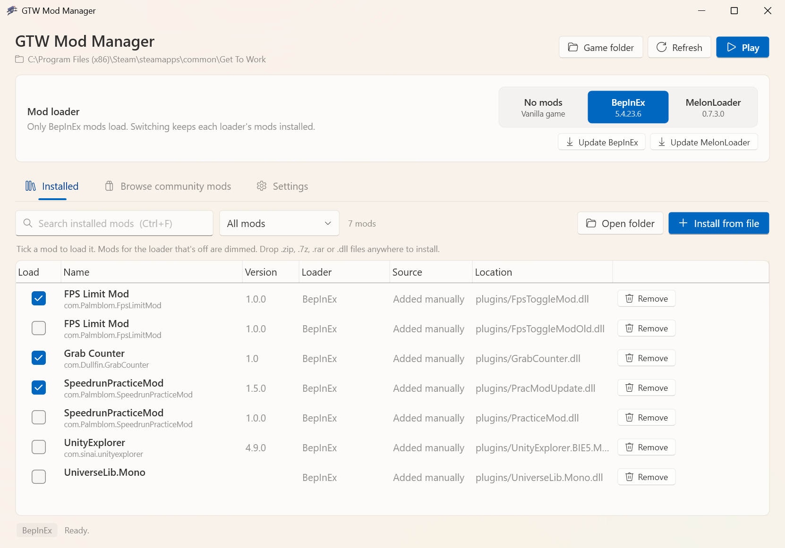
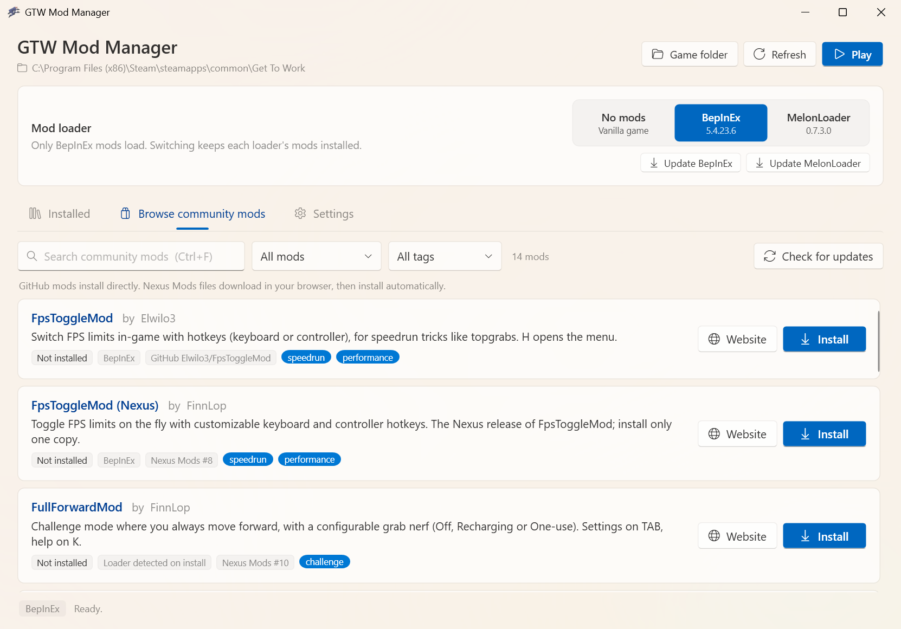
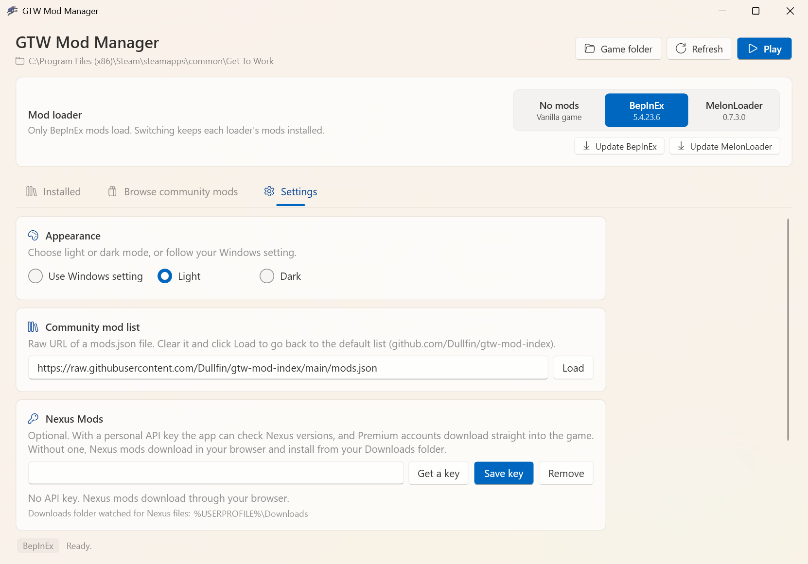

# GTW Mod Manager

A Windows mod manager for **Get To Work** (Unity Mono). Supports both **BepInEx 5** and **MelonLoader**.

**[Download the latest release](https://github.com/Dullfin/gtw-mod-manager/releases/latest)**: grab `GTWModManager-<version>-win-x64.exe` and run it. No installer, and it updates itself.

<picture>
  <source media="(prefers-color-scheme: dark)" srcset="docs/screenshots/installed-dark.png">
  
</picture>

<table>
  <tr>
    <td width="50%">
      <picture>
        <source media="(prefers-color-scheme: dark)" srcset="docs/screenshots/browse-dark.png">
        
      </picture>
      <p align="center"><b>Browse community mods</b> from GitHub and Nexus Mods</p>
    </td>
    <td width="50%">
      <picture>
        <source media="(prefers-color-scheme: dark)" srcset="docs/screenshots/settings-dark.png">
        
      </picture>
      <p align="center"><b>Settings</b>: light or dark mode, mod list, Nexus key</p>
    </td>
  </tr>
</table>

Screenshots follow your GitHub theme; the app follows your Windows one.

## Features

- **Finds the game** through Steam.
- **Mod loader profiles:** pick *No mods*, *BepInEx* or *MelonLoader* at the top. One click installs or updates either loader from GitHub.
  - Each loader starts the game through its own DLL (`winhttp.dll` for BepInEx, `version.dll` for MelonLoader). The inactive one is renamed to `*.gtwmm-disabled`, so the two never run together.
  - Each loader keeps its own mods (`BepInEx\plugins\` vs `Mods\`), so switching is instant and nothing is reinstalled.
  - *No mods* parks both, for a clean unmodded game.
- **Installed tab:** tick or untick mods to load them. Unticked mods move to a `_disabled` twin folder (`plugins_disabled\`, `Mods_disabled\` …) that the loaders never scan. Mods for the loader that's off are greyed out.
- **Detects the loader for you:** mod names, versions and IDs are read from the DLLs without running them (`[BepInPlugin]` for BepInEx, `[assembly: MelonInfo]` for MelonLoader). If a mod needs a loader that isn't installed, the app offers to install it, then offers to switch.
- **Install from file:** a button or drag-and-drop takes `.zip`, `.7z`, `.rar` or `.dll`. 7z and rar use Windows' built-in `tar.exe`. Mod downloads are never allowed to overwrite loader files.
- **Flags DLLs sitting directly in `BepInEx\`**, where BepInEx ignores them, and offers **Move into plugins**.
- **Browse community mods** tab: reads the [community list](https://github.com/Dullfin/gtw-mod-index).
  - GitHub mods install directly.
  - **Nexus Mods:** Get To Work mods on Nexus only offer "Manual download", so Install opens the mod's Files page in your browser and installs the file as soon as it lands in your Downloads folder ("Choose file instead…" works too). With a **Nexus Premium** API key (Settings tab), downloads go straight into the game. Any API key also enables Nexus version checks. The key is stored encrypted with Windows DPAPI.
- **Safe removal:** removed mods go to `GTWModManager\trash\` in the game folder. Settings (`BepInEx\config\`, `UserData\`) are kept across removals and updates.
- Refuses to change anything while the game is running.
- **Updates itself:** at startup it checks the latest GitHub release of this repo. If there's a newer version, a banner offers *Update now*: the app downloads the matching exe (standalone or .NET 9), checks it against `SHA256SUMS.txt`, renames itself to `*.old`, moves the new exe into place and restarts. The next start deletes the `.old` copy. *Skip this version* hides the banner for that version, and Settings → About can check by hand. This only works while the repo is **public**; for a private repo GitHub returns nothing and the app stays quiet.

The manager records what it installed in `GTWModManager\installed.json` in the game folder. Version 0.1's `BepInEx\modmanager\` folder is moved there automatically.

## Build and run

```powershell
dotnet build GTWModManager.sln -c Release
```

```powershell
.\src\GTWModManager\bin\Release\net9.0-windows\GTWModManager.exe
```

## Releasing

The built-in updater looks for exact file names, so always build releases with the script:

1. Bump `<Version>` in `src/GTWModManager/GTWModManager.csproj` and commit.
2. Build and publish (tags `v<version>`, pushes the tag, creates the GitHub release with both exes and `SHA256SUMS.txt`):

```powershell
.\tools\build-release.ps1 -Publish -NotesFile notes.md
```

Without `-Publish` it only builds into `publish\release`. Everyone on an older version then sees the update banner the next time they start the app.

To test an update locally, serve a fake `latest.json` (same shape as GitHub's release API) and start the app with `GTWMM_UPDATE_URL` pointing at it.

Smoke tests (use a throwaway folder; `--online` also downloads the GitHub mods and MelonLoader):

```powershell
dotnet run --project tests/GTWModManager.SmokeTest -- "$env:TEMP\gtw-fake" "C:\Program Files (x86)\Steam\steamapps\common\Get To Work" --online
```

## The community mod list

The app reads `mods.json` from [Dullfin/gtw-mod-index](https://github.com/Dullfin/gtw-mod-index). Mod authors add their mod with a pull request there, and a check validates the file on every PR. The format is documented in that repo's README. `index/mods.json` here is the copy built into the app, used only when GitHub can't be reached; refresh it from the repo before each release. Another list can be used from the Settings tab.

Without sign-in, GitHub allows 60 API requests per hour, and each GitHub mod checked uses one.

### Nexus API terms

A personal API key is fine for your own use. If you distribute the app widely, Nexus asks mod managers to register an application slug and use their SSO sign-in instead of asking users to paste keys; that's a change to `NexusClient` and the Settings tab.

## Layout

| Path | What |
|---|---|
| `src/GTWModManager.Core` | Game and loader detection, loader switching, archive handling, install/uninstall, GitHub and Nexus clients |
| `src/GTWModManager` | WPF app |
| `tests/GTWModManager.SmokeTest` | End-to-end checks against a fake game folder |
| `tests/FakeMelonMod` | A stand-in MelonLoader mod used by the tests |
| `index/mods.json` | Built-in fallback copy of the community list |
| `tools/build-release.ps1` | Builds the release exes with the names the updater expects, and publishes the release |
